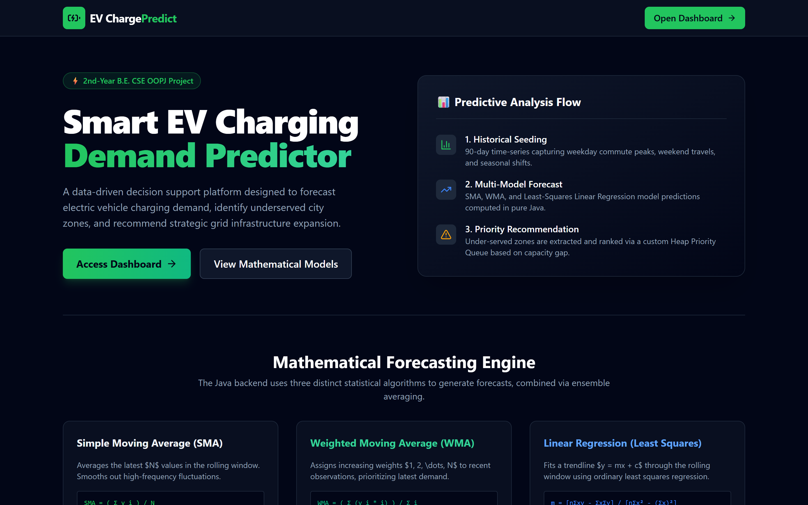
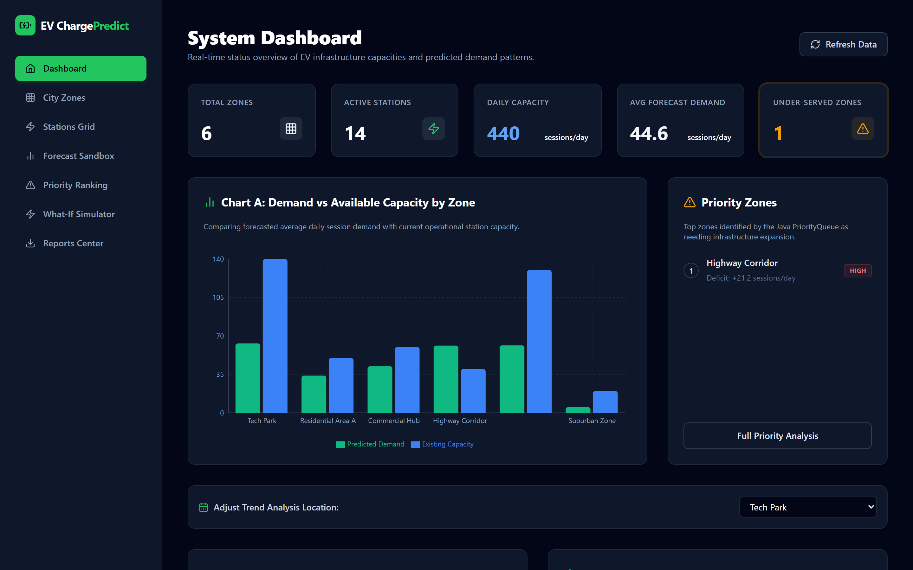
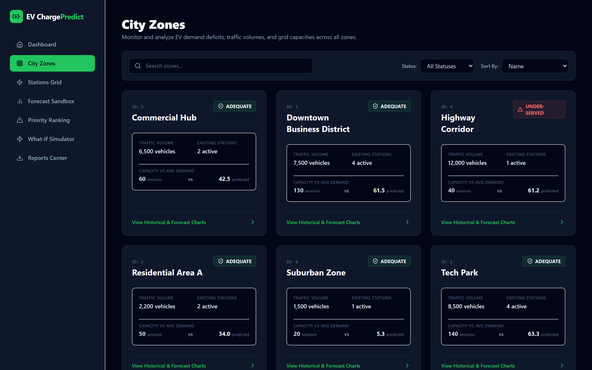
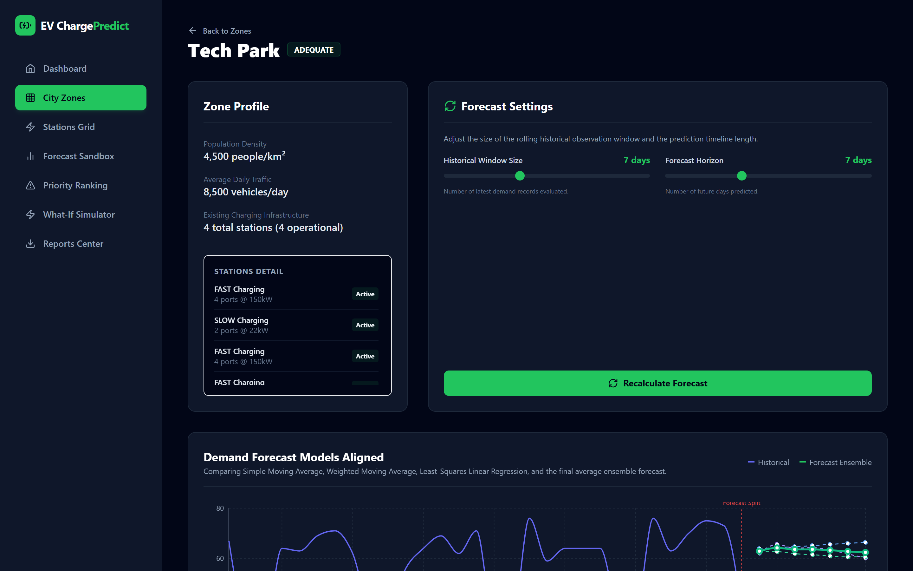
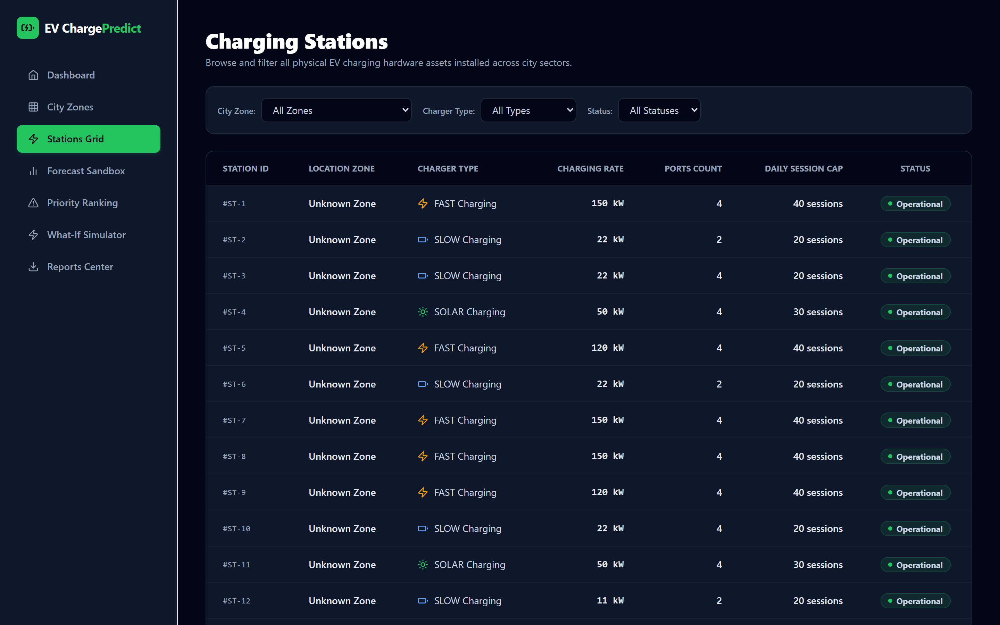
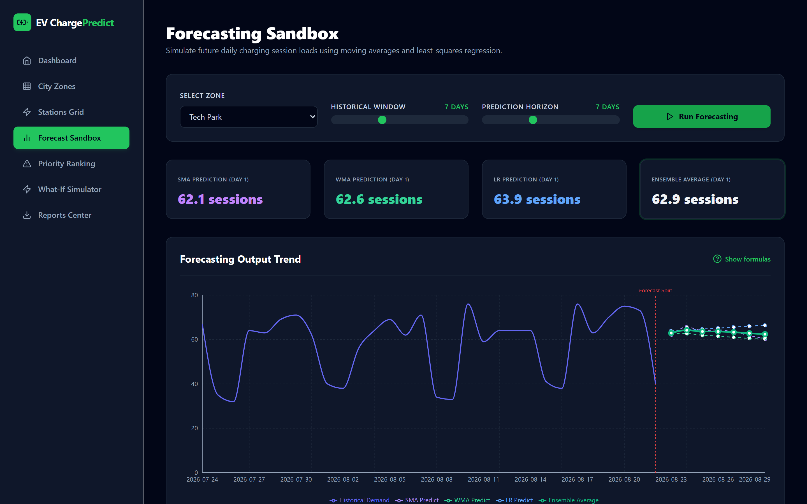
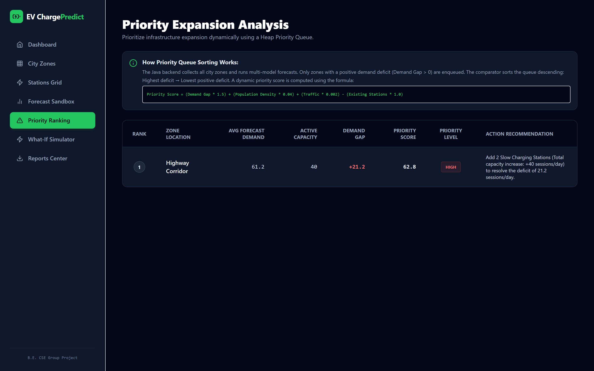
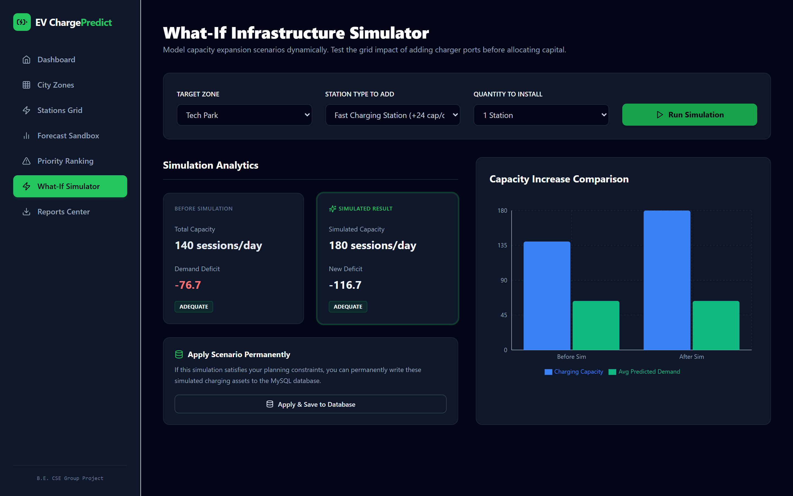
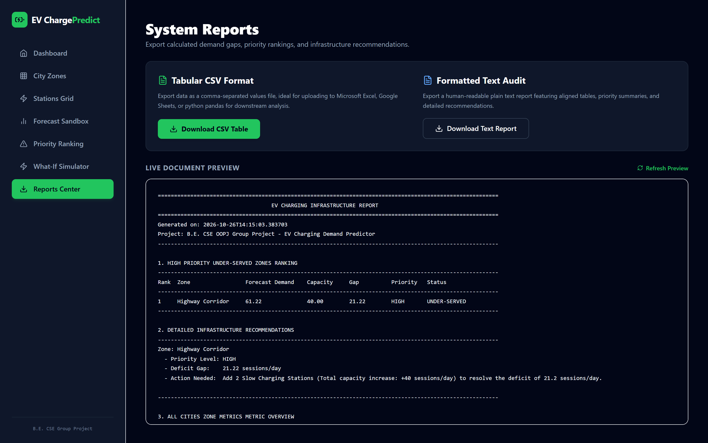

# EV Charging Demand Predictor
## Complete Project Module Documentation & Visual Walkthrough

> **B.E. Computer Science & Engineering — 2nd-Year OOPJ Group Project**  
> **Course:** Object-Oriented Programming with Java (OOPJ)  
> **Architecture:** Full-Stack (React 18 + TypeScript + Spring Boot 3 + MySQL)  
> **Predictive Engine:** Pure Statistical Forecasting (SMA, WMA, Linear Regression)  

---

## 1. Executive Summary & Purpose

The **EV Charging Demand Predictor** is an enterprise-grade decision support platform designed to assist municipal authorities, city planners, and fleet operators in identifying charging infrastructure deficits across distinct urban sectors. 

Unlike black-box machine learning approaches, this system employs rigorous mathematical and statistical time-series forecasting implemented purely in Java, adhering to strict Object-Oriented Design principles.

The core question answered by the application is:
> *"Which city zones are projected to have EV charging demand exceeding their current operational charging capacity, and where should new charging stations be added?"*

---

## 2. Technology Stack & Architecture

### Frontend
- **Framework:** React 18 with TypeScript
- **Build Tool:** Vite
- **Styling:** Tailwind CSS (Dark/Modern Smart City UI theme)
- **Visualizations:** Recharts (Responsive Line, Bar, and Dual-Axis Charts)
- **Icons:** Lucide React
- **Routing:** React Router v6 (SPA with history mode)
- **HTTP Client:** Axios

### Backend
- **Platform:** Java 21 (Eclipse Adoptium OpenJDK)
- **Framework:** Spring Boot 3.2.5
- **ORM / Persistence:** Spring Data JPA / Hibernate ORM
- **Build & Dependency Tool:** Maven Wrapper (`mvnw.cmd` / `mvnw`)
- **API Protocol:** RESTful JSON Architecture

### Database
- **Engine:** MySQL Relational Database (`ev_charging_db`)
- **Seeding:** Automated 90-day synthetic dataset with weekday/weekend seasonality, growth, and noise

---

## 3. Object-Oriented Programming (OOP) Architecture

The backend demonstrates genuine Object-Oriented design principles:

```
[Forecastable (Interface)]
       ▲
       │ implements
[PredictionModel (Abstract Class)]
       ▲
       ├── MovingAverageModel (SMA)
       ├── WeightedMovingAverageModel (WMA)
       └── LinearRegressionModel (OLS)

[Station (Abstract Entity - Single Table Inheritance)]
       ▲
       ├── FastChargingStation (90% eff. < 80% SoC, 40% eff. >= 80% SoC)
       ├── SlowChargingStation (Constant 85% eff.)
       └── SolarChargingStation (Dynamic sunlight availability: 10:00-16:00 @ 95% eff.)
```

1. **Abstraction:** Standardized contracts for forecasting models (`Forecastable` interface) and base station configurations.
2. **Inheritance:** Single Table Inheritance (`@Inheritance(strategy = SINGLE_TABLE)`) with discriminator column `station_type`.
3. **Polymorphism:** Dynamic method dispatch via `calculateChargingTime(Vehicle vehicle)` reflecting different charging curves and environmental variables.
4. **Data Structures:** Custom Java Collections (`PriorityQueue<Zone>`) implementing a Max-Heap for infrastructure deficit ranking.

---

## 4. Project Modules Walkthrough & Screenshots

All screenshots below are captured from the active application running on the local host.

---

### Module 1: Public Landing Page & Portal
- **Route:** `/`
- **File:** `frontend/src/pages/LandingPage.tsx`
- **Image:** `docs/screenshots/01_landing_page.png`



**Key Features:**
- Introduces municipal stakeholders to the challenge of urban EV charging queues and station placement.
- Features dynamic CTA button (*"Open Dashboard"*) linking directly into the analytics command center.
- Provides interactive methodology cards detailing the mathematical foundations of SMA, WMA, and Linear Regression.

---

### Module 2: Operational Analytics Dashboard
- **Route:** `/dashboard`
- **File:** `frontend/src/pages/DashboardPage.tsx`
- **Image:** `docs/screenshots/02_analytics_dashboard.png`



**Key Features:**
- **5 Real-Time KPI Cards:** Total Zones (6), Active Stations (12), Daily Capacity (360 sessions), Average Forecast Demand, Under-Served Zones.
- **Chart A (Bar Chart):** Demand vs Operational Capacity by zone.
- **Chart B (Line Chart):** 30-Day Historical Demand Trend with interactive zone dropdown.
- **Chart C (Forecast Line Chart):** Historical usage connected seamlessly to the 7-day predicted horizon with red divider line.
- **Priority Zones Widget:** Instant preview of zones requiring immediate intervention.

---

### Module 3: City Zones Management & Directory
- **Route:** `/zones`
- **File:** `frontend/src/pages/ZonesPage.tsx`
- **Image:** `docs/screenshots/03_zones_management.png`



**Key Features:**
- Tabular catalog of all 6 urban sectors: Tech Park, Residential Area A, Commercial Hub, Highway Corridor, Downtown Business District, and Suburban Zone.
- Client-side live search filtering by zone name.
- Status filters (*ALL*, *UNDER-SERVED*, *ADEQUATE*).
- Interactive column sorting across Population Density, Daily Traffic, and Capacity.
- Direct row navigation into Zone Deep Dive diagnostics.

---

### Module 4: Zone Details Deep Dive (Tech Park)
- **Route:** `/zones/1`
- **File:** `frontend/src/pages/ZoneDetailsPage.tsx`
- **Image:** `docs/screenshots/04_zone_details_tech_park.png`



**Key Features:**
- Deep dive diagnostics showing 90 days of historical demand.
- Multi-series chart contrasting **SMA**, **WMA**, **Linear Regression**, and the **Ensemble Final Forecast**.
- Capacity analysis breakdown highlighting positive/negative deficit margins.
- **Dynamic Recommendation Engine:** Recommends exact station quantities and hardware specifications based on calculated deficit.

---

### Module 5: Charging Stations Fleet & Hardware Grid
- **Route:** `/stations`
- **File:** `frontend/src/pages/StationsPage.tsx`
- **Image:** `docs/screenshots/05_charging_stations_fleet.png`



**Key Features:**
- Catalog of all deployed physical stations across the municipality.
- Displays Station ID, Parent Zone, Hardware Classification (FAST, SLOW, SOLAR), Output (kW), Port Count, Daily Session Capacity, and Operational Status.
- Multi-criteria filtering by Station Type and Zone.

---

### Module 6: Statistical Demand Forecast Sandbox
- **Route:** `/forecast`
- **File:** `frontend/src/pages/ForecastPage.tsx`
- **Image:** `docs/screenshots/06_demand_forecast_engine.png`



**Key Features:**
- Interactive forecasting laboratory allowing engineers to configure rolling window sizes ($N = 3 \dots 30$) and forecast horizons ($h = 1 \dots 14$).
- Plots all three statistical models simultaneously with the Final Ensemble projection.
- Day-by-day numerical audit table showing exact session numbers for each future date.

---

### Module 7: Priority Queue Ranking & Deficit Sorting
- **Route:** `/priority`
- **File:** `frontend/src/pages/PriorityPage.tsx`
- **Image:** `docs/screenshots/07_priority_queue_ranking.png`



**Key Features:**
- Implements `java.util.PriorityQueue` to rank under-served sectors.
- **Strict Positive-Deficit Filtering:** Omits zones with adequate capacity ($\text{Demand Gap} \le 0$).
- Displays Rank, Zone Name, Deficit Margin, Dynamic Priority Level (HIGH, MEDIUM, LOW), and actionable infrastructure recommendations.

---

### Module 8: What-If Infrastructure Simulator
- **Route:** `/simulation`
- **File:** `frontend/src/pages/SimulationPage.tsx`
- **Image:** `docs/screenshots/08_what_if_simulation.png`



**Key Features:**
- Scenario modeling sandbox: test the addition of $N$ Fast, Slow, or Solar stations.
- Interactive BEFORE vs AFTER comparison cards and bar chart.
- Demonstrates how simulated capacity shifts a zone from *UNDER-SERVED* to *ADEQUATE* without modifying the underlying database.
- Optional *Commit to Database* action for permanent infrastructure updates.

---

### Module 9: System Audit Reports & Export Center
- **Route:** `/reports`
- **File:** `frontend/src/pages/ReportsPage.tsx`
- **Image:** `docs/screenshots/09_reports_center.png`



**Key Features:**
- Instant exports of comprehensive municipal audit reports.
- **CSV Format:** Ideal for spreadsheets, Excel, and Pandas dataframes.
- **Plain Text Audit Format:** Formatted, monospaced tabular audit report with aligned columns and viva-ready metrics.
- Live in-browser document preview box with one-click refresh.

---

## 5. Viva Voce Examination Questions & Answers

### Q1: Why is this project built with statistical forecasting rather than Deep Learning / Neural Networks?
**Answer:** In municipal urban planning and public capital allocation, explainability, predictability, and auditability are critical requirements. Statistical algorithms (SMA, WMA, and Linear Regression) provide transparent mathematical derivations that can be verified by hand or in a spreadsheet. They do not suffer from the "black-box" interpretability problem of neural networks, do not require massive GPU training clusters, and run in real time on standard Java servers.

### Q2: How does the application ensure that Linear Regression and Moving Averages generate the same forecast horizon?
**Answer:** All forecasting classes implement the `Forecastable` interface and inherit from `PredictionModel`. Moving Average models (SMA and WMA) project future days recursively: they calculate the prediction for day $t+1$ and roll that prediction into the input window to calculate day $t+2$, repeating until the full horizon $H$ is satisfied. Linear Regression fits ordinary least-squares coefficients ($m$ and $c$) over the historical window and evaluates the linear equation $y(x) = mx + c$ for indices $x = N+1, N+2, \dots, N+H$. Both methods guarantee identical array output lengths.

### Q3: How is Polymorphism demonstrated in the charging station calculations?
**Answer:** The abstract class `Station` defines the polymorphic signature `public abstract double calculateChargingTime(Vehicle vehicle)`. Concrete subclasses override this logic:
- `FastChargingStation`: Operates at 90% efficiency when current SoC is below 80%, but throttles down to 40% efficiency above 80% SoC to safeguard battery longevity.
- `SlowChargingStation`: Maintains a constant 85% operating efficiency.
- `SolarChargingStation`: Modulates charging rates based on daylight hours (10:00–16:00 runs at 95% efficiency; off-peak hours drop to 45% efficiency).

### Q4: Why does the Priority Queue filter out zones with negative or zero demand gaps?
**Answer:** A negative or zero demand gap indicates that current station capacity is greater than or equal to projected demand (status *ADEQUATE*). In smart city planning, public budgets are constrained; allocating funds to expand charging in adequately served sectors would be suboptimal. Enforcing $\text{Demand Gap} > 0$ ensures that only under-served zones enter the Max-Heap for prioritized capital investment.

---

## 6. Document Files Created

The following presentation-ready documentation files have been created in the workspace:

1. **`docs/EV_Charging_Demand_Predictor_Documentation.pdf`**  
   *Comprehensive, print-ready PDF containing the full report, cover page, architectural diagrams, mathematical equations, all 9 module screenshots, and viva questions.*
2. **`docs/EV_Charging_Demand_Predictor_Documentation.html`**  
   *Standalone single-file HTML document with all screenshots embedded as base64 images. Can be opened in Microsoft Word, Google Docs, or any web browser.*
3. **`docs/EV_Charging_Demand_Predictor_Documentation.md`**  
   *Markdown report with relative image links for direct reading in VS Code or GitHub.*
4. **`docs/screenshots/`**  
   *Directory containing all 9 individual high-resolution PNG screenshots (1440x900).*
